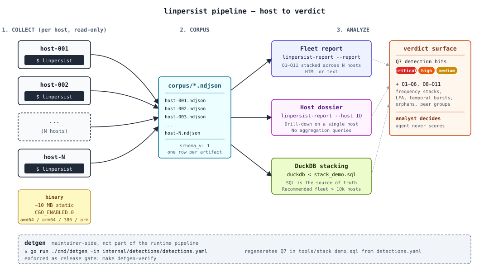
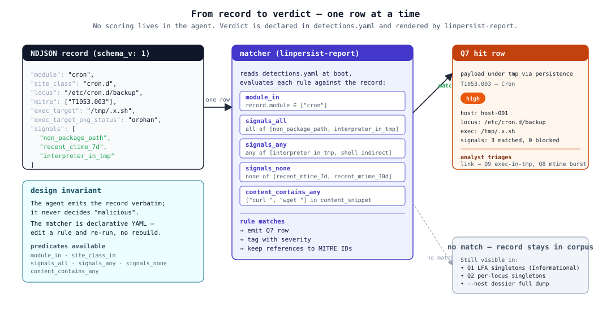
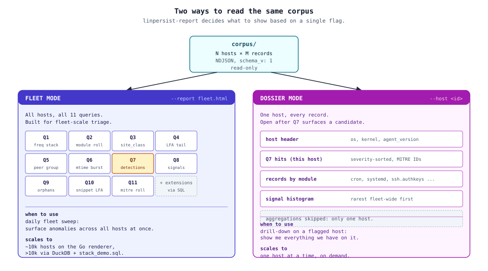
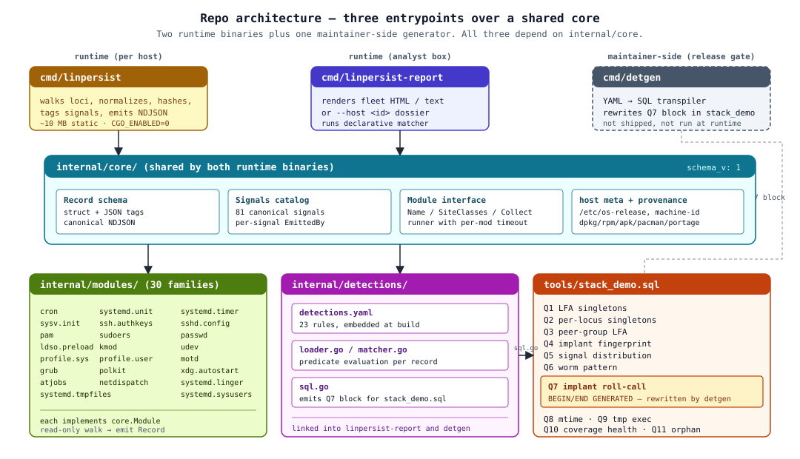

# linpersist

> Linux persistence-artifact collector built for fleet-scale hunting.
> One static Go binary per host emits NDJSON; a second binary turns
> the fleet's output into a triage report or a per-host dossier.
> Detections live in declarative YAML, validated at build time. No
> CGO, no daemons, no network calls.

Find the malicious cron line, the `LD_PRELOAD` injection, the
sneaky `/etc/sudoers.d/` backdoor across **thousands of hosts** by
turning every Linux persistence site into a hash, stacking those
hashes, and reading the long tail — the singletons. Everything an
attacker plants for persistence lives there.



## Why bother — what only this tool does well

The persistence hunt looks like this in practice: you have 800 cron
files spread across 200 hosts. 798 of them are `logrotate`, `man-db`,
`apt-news`, `mlocate.cron` and friends. Two are an attacker's drop.

A SIEM with content rules won't catch them — the attacker named
their file `update-poll` and the content is plausible. An EDR with
behavioural rules might catch the *execution* tomorrow, but by then
the implant has been on disk for weeks.

What you want is the structural anomaly: the cron records whose
*canonical content hash* appears on exactly one host across the
fleet. That's the implant, by construction.

linpersist does one job and one job only: makes that question
cheap to ask, against any size of Linux fleet, with persistence
coverage broad enough to catch the modern repertoire.

- **Coverage**: 30 module families across 62 persistence
  site_classes — cron, systemd units/timers/sysusers/tmpfiles/
  linger, ssh authorized_keys, sshd_config, sudoers, PAM,
  `/etc/passwd`, `/etc/shadow`, `ld.so.preload`, modprobe.d,
  udev RUN+=, polkit JS rules, XDG autostart, GRUB cmdline,
  network dispatchers, sysv init, MOTD update-motd.d, and more.
  Maps onto MITRE ATT&CK Linux Persistence (T1037, T1053, T1098,
  T1136, T1543, T1546, T1547, T1548, T1556, T1574, T1542) at ~80%
  coverage.
- **Stackable output**: NDJSON with `content_norm_sha256` per
  record. Two semantically-equivalent inputs across hosts produce
  the same hash. The whole hunt model collapses to "show me the
  hashes nobody else has".
- **Detections as data**: 56 detection rules in a single YAML file
  that both the report binary and the SQL companion consume. A
  release gate fails the build if the two drift.
- **Per-host dossier on demand**: when a fleet query flags a
  candidate, one command produces a ~20 KB HTML page with the
  host's signal-rarity panel, per-Q breakdown, and a module-
  coverage gap detector.

What linpersist explicitly does NOT do: classify anything as
malicious on the host, score, run YARA, load eBPF programs, make
network calls, or write to any path other than the file you give
it with `--output`. The agent collects; the backend decides.

## 60-second tour

```sh
# 1. Clone and build.
git clone https://github.com/jarmidaw/linpersist.git
cd linpersist
make build-all      # cross-compiles for linux/{amd64,arm64,386,armv7}

# 2. Run the agent on one host (your own laptop will do).
./dist/linpersist-linux-amd64 > my-host.ndjson
wc -l my-host.ndjson    # one line per persistence record found

# 3. Render the report.
./dist/linpersist-report -i my-host.ndjson -o report.html
xdg-open report.html
```

That's the whole loop. For a real fleet, scp the per-host NDJSON
back to a central box, point `-i` at the directory, and let
`linpersist-report` aggregate.

## How the model works in two paragraphs

**Collection.** The agent walks every well-known Linux persistence
site (per the `matrix.yaml` table) and emits one NDJSON record per
artifact. The two load-bearing fields are `content_norm_sha256` — a
hash over a canonical form of the content (whitespace collapsed,
comments stripped, option lists sorted, etc.) so that semantically-
identical artifacts across hosts collapse to one hash — and
`signals[]` — a small list of cheap flags the agent observed (file
mtime in the last 7 days, `exec_target` doesn't exist on disk,
binary is not owned by any installed dpkg/rpm package, etc.). No
verdicts. No scoring.

**Analysis.** The report binary loads the NDJSON and runs twelve
canonical queries. The load-bearing one is Q1: every
`(module, site_class, content_norm_sha256)` group seen on exactly
one host in the fleet. Implants live in that long tail by
construction — **but content-rarity only discriminates where a
valid comparand population exists.** A unique-role host (the one
DB, the one bastion, the one CI box) has files that are unique
*by design*, so the report descends a **discriminator ladder**
(ADR-0017): a record with a structural tell (orphan exec_target,
non-package path, tmp-class, tamper, recent change) is **actionable
regardless of fleet size**; a bare content-singleton with no tell
is shown as **informational** — ranked and never suppressed, but
triage material, not a verdict. See "Strengths and limitations"
below. The other queries refine the picture — peer-group LFA by
`os_id`+tags, cross-cutting implant fingerprints, worm patterns,
recent-mtime spikes, host-coverage gaps, campaign basename
clusters. Q7 is special: it matches every record against the rules
declared in `internal/detections/detections.yaml` and outputs the
rule id that fired plus a severity tier. Q11 catches the implant
subclass "unmanaged binary outside `/tmp`" via package-manager
provenance.



## How you use it

### Agent (on each host you want covered)

```sh
linpersist                              # NDJSON to stdout
linpersist --output /tmp/host.ndjson    # NDJSON to file (the only write the agent does)
linpersist --include-hostname           # opt-in: emit plaintext hostname
linpersist --module-timeout 60s         # per-module deadline, default 30s
linpersist --tag role=build             # operator-provided tag, attached to host_meta.tags
linpersist --version
```

The agent makes zero network calls. It does zero writes to the
host disk except the file given by `--output` (and if not given,
just stdout). Expect 500 KB to 2 MB of NDJSON per host depending
on how many persistence artifacts that host carries.

### Report (on the analyst's box, with the fleet's NDJSON)

Two modes, same binary.

**Fleet mode** — the default. One HTML page with all twelve
queries plus an overview. Scales to tens of thousands of hosts
because the queries aggregate, not enumerate.

```sh
# HTML (self-contained, openable in any browser, ~200 KB)
linpersist-report -i fleet/ -o report.html

# Text mode for jump hosts (SSH-only, no browser available)
linpersist-report -i fleet/ -format text -color=off > triage.txt
linpersist-report -i fleet/ -format text | less -R     # paged, with ANSI colour
```

**Dossier mode** — the deep drill on one host. Triggered with
`--host <id>` (matched against `host_meta.hostname` or `host_id`).
Used after a fleet query flags a candidate.

```sh
linpersist-report -i fleet/ --host r-db-amzn-03 -o r-db-amzn-03.html

# Batch dossiers for a list of candidates:
for h in $(cat suspects.txt); do
  linpersist-report -i fleet/ --host "$h" -o "out/$h.html"
done
```

The dossier produces a ~20 KB self-contained HTML per host with:
host metadata, summary counts, a **signal panel sorted by fleet
rarity ascending** (the rarest signal across the fleet that this
host fires shows first), per-Q sub-tables filtered to the host,
and a **module-coverage gap detector** flagging modules the host
emitted zero records for when the fleet median is non-zero
(silent agent failure, container image gap).



### Power-user path: DuckDB

For fleets past ~10k hosts the Go report binary stays usable but
columnar processing scales better. The twelve queries are mirrored
into executable DuckDB SQL in `tools/stack_demo.sql`. The Q7 block
is auto-generated from `internal/detections/detections.yaml`;
everything else is hand-written.

```sh
./tools/ingest.sh fleet/                           # runs the 11 queries
./tools/ingest.sh -q my-hunt-pack.sql fleet/       # bring your own queries
./tools/ingest.sh -d fleet.duckdb fleet/           # persist the database
duckdb fleet.duckdb -c "SELECT module, count(*) FROM r GROUP BY 1"
```

Walk-through with prose and false-positive notes per query lives
at [`docs/stacking-cookbook.md`](docs/stacking-cookbook.md).

## What you'll see in the report

The Overview gives you the headline counts. Real numbers from a
75-host lab fleet:

```
Overview
--------
  hosts:                     75
  records:                   35,349
  modules:                   21
  site_classes:              32
  Q1 singletons:             26
  Q4 implant hits:           6
  Q7 roll-call:              22
    critical:                13
    high:                    9
  Q8 mtime spikes:           40
  Q11 orphan outside tmp:    6
```

The query everyone clicks first is Q7. It cross-cuts every module:
one row per record that matches a detection rule. Each row tells
you what host, what site, the exec_target if the record has one,
the rule that fired, and the signals behind it.

```
severity  host          module   site_class    locus                                    exec_target     matched_detections                 triage_signals
critical  r-db-amzn-03  systemd  systemd.unit  /etc/systemd/system/rsync-cache.service  /tmp/.s/cacher  payload_under_tmp_via_persistence  exec_target_orphan,interpreter_in_tmp
critical  r-db-amzn-01  passwd   passwd.user   /etc/passwd                              /bin/bash       second_uid_zero_account            passwd_uid_zero
high      r-k8s-node-01 kmod     kmod          /etc/modprobe.d/zz_helper.conf           /bin/sh         kmod_install_directive_implant     kmod_install_directive,shell_indirect
```

What the analyst reads, in order: severity first (red for
critical, orange for high), `matched_detections` second (this
tells them which rule fired by name), then the locus + exec_target
to know what to investigate.

When that row points at a host worth a closer look, the dossier:

```sh
linpersist-report -i fleet/ --host r-db-amzn-03 -o /tmp/dossier.html
```

opens with the host's signal panel sorted by rarity. If
`polkit_yes_constant` fires on this host and 14/75 of the fleet,
it's mid-table. If `ld_preload_set` fires on this host and only
1/75 of the fleet, it bubbles to the top regardless of severity.
That's where the implant lives.

**Reading Q1 — the two groups.** Q1 is split into **Actionable**
(rung 1: the singleton carries a structural co-indicator, so it is
real regardless of fleet population — triage these first, ranked by
the `co` count) and **Informational** (rung 4: a bare content-novelty
singleton with no tell). The informational group is *never
suppressed* — at N=1 every record is a singleton, so rarity alone is
weak, but the genuinely-rare single-host implant can hide here too.
Each informational row is tagged `disc=novelty-only` (provenance was
structurally inapplicable, e.g. a web docroot — no tell was ever
possible) or `disc=no-tell` (a tell could have fired and did not).
You restore verdict-power on these by getting a sized peer cohort
(deploy across role replicas), a prior snapshot (re-scan over time,
diff mode), or by pairing with EDR.

**The coverage-degraded banner.** If a host has no detectable package
manager (distroless / from-scratch / appliance image), the
provenance gate could not run and the report shows an orange banner
naming those hosts. "0 findings" there means *could not verify*, not
*clean* — treat those hosts as **higher** priority for manual review,
not lower.

## Strengths and limitations — read before you trust a clean report

**What it does well (bondades).**

- **Fleet-scale rarity hunting.** Turn every persistence site into a
  canonical hash, stack across the fleet, read the singletons. One
  malicious cron line among thousands of identical hosts is the rare
  hash and surfaces in seconds. The queries aggregate, so it scales to
  tens of thousands of hosts.
- **Zero-FP-by-construction collection.** A module emits a record only
  when a real structural tell is present; detections gate on a
  co-indicator (orphan / non-package / tamper / tmp-class) plus rarity.
  A settled, package-owned baseline is silent.
- **Package-provenance truth.** dpkg / rpm / apk / pacman / portage
  ownership and integrity (`non_package_path`, `package_file_tampered`)
  separate planted/edited files from the distro baseline across distros.
- **Honest, point-in-time, agentless.** One static binary, no CGO, no
  daemon, no network egress. Drop it, run it once, collect the NDJSON,
  remove it. Nothing resident, nothing to attack later.
- **Disciplined detections.** Rules live in declarative YAML, validated
  and Go↔SQL-equivalence-checked at build time; the same logic runs in
  the Go report and in DuckDB.

**What it cannot do (limitaciones — be honest with the client).**

- **The peerless single-role host (ADR-0017).** Rarity needs a
  comparand. A host with no homogeneous peer for a given site_class
  produces unique-by-design files that land in Q1 *Informational*. A
  settled, tell-free implant on such a host, seen on first contact (no
  prior snapshot), is a `co=0` singleton **indistinguishable** from the
  benign unique files at the same locus. There linpersist does triage,
  not adjudication. Mitigate by deploying across replicas, re-scanning
  over time, or pairing with EDR.
- **Provenance is a trust oracle, not attestation.** A
  malicious-but-package-*owned* binary (poisoned repo, trojaned package,
  compromised package DB) resolves `owned` and stays silent. Pair with
  SBOM / signature verification for supply-chain integrity.
- **Point-in-time, on-disk only.** No memory, no kernel, no eBPF, no
  firmware, no runtime view. Process injection, `memfd` payloads, an
  `LD_PRELOAD` already resident in a running process whose on-disk
  config is gone, bind-mount/overlay shadowing, rootkit-hidden dirents —
  all out of scope by design (Regime 3, ADR-0016). Pair with a runtime
  sensor for the kernel/memory surface.
- **Homogeneous golden-image fleets weaken LFA.** If an implant is baked
  into the image, it is fleet-common, not rare. Heterogeneity (or a
  diff against a known-clean image) is the discriminator.
- **It reports patterns, not verdicts.** The analyst's judgement is
  required. A non-package binary may be a vendor install; a NOPASSWD
  sudoers entry may be a CI service account.

The full coverage philosophy and boundaries are in
[`docs/scope.md`](docs/scope.md) §8 and
[`docs/adr/0016-coverage-philosophy.md`](docs/adr/0016-coverage-philosophy.md)
/ [`0017-discriminator-ladder.md`](docs/adr/0017-discriminator-ladder.md).

## A sample record

The wire format the agent emits, NDJSON, one record per line:

```json
{
  "schema_v": 1,
  "host_id": "8f3b1e2a-...",
  "host_meta": {
    "hostname_hash": "sha256:abc12...",
    "os_id": "ubuntu", "os_version": "22.04",
    "kernel": "5.15.0-91-generic", "arch": "x86_64",
    "boot_id": "f0a8...", "tags": []
  },
  "collected_at": "2026-05-20T10:00:00Z",
  "agent_version": "linpersist-0.3.0",
  "module": "cron",
  "site_class": "cron.d",
  "mitre": ["T1053.003"],
  "locus": "/etc/cron.d/update-helper",
  "owner_uid": 0, "owner_gid": 0, "mode": "0644",
  "mtime": "2026-05-10T03:14:00Z",
  "size": 142,
  "content_sha256": "ab12...",
  "content_norm_sha256": "cd34...",
  "content_snippet": "*/5 * * * * root /tmp/.h/agent",
  "exec_target": "/tmp/.h/agent",
  "exec_target_pkg": null,
  "exec_target_pkg_status": "orphan",
  "signals": ["exec_target_orphan", "interpreter_in_tmp", "non_package_path"]
}
```

Full field reference at
[`docs/schema-v1.md`](docs/schema-v1.md).

## Coverage

| Family | Module | Sites | MITRE |
|---|---|---|---|
| Schedulers | `cron` | `/etc/crontab`, `/etc/cron.d/`, `/var/spool/cron/`, `/etc/cron.{hourly,daily,weekly,monthly}/`, `/etc/anacrontab` | T1053.003 |
| Schedulers | `atjobs` | `/var/spool/at/`, `/var/spool/cron/atjobs/` | T1053.001 |
| Service init | `systemd` | `.service` + `.timer` files under system + user loci, drop-ins, Match-block scoping | T1543.002, T1053.006 |
| Service init | `sysv` | `/etc/init.d/`, `/etc/rc.d/`, `rc[0-6].d/` symlinks, `rc.local` | T1037.004 |
| Service init | `systemd.tmpfiles` | `/etc/tmpfiles.d/`, `/usr/lib/tmpfiles.d/`, `/run/tmpfiles.d/` | T1543.002 |
| Service init | `systemd.sysusers` | `/etc/sysusers.d/`, `/usr/lib/sysusers.d/` | T1136.001 |
| Service init | `systemd.linger` | `/var/lib/systemd/linger/<user>` | T1546 |
| Identity | `passwd` | `/etc/passwd`, `/etc/shadow`, `/etc/group`, `/etc/gshadow` (hashes never emitted) | T1136.001 |
| SSH | `ssh` | `/root/.ssh/authorized_keys`, `/home/*/.ssh/authorized_keys`, system-wide variants | T1098.004 |
| SSH | `sshd` | `/etc/ssh/sshd_config`, drop-ins, Match blocks | T1098.004, T1556 |
| AuthN/Z | `pam` | `/etc/pam.d/*`, `/etc/pam.conf` | T1556.003 |
| AuthN/Z | `sudoers` | `/etc/sudoers`, `/etc/sudoers.d/` | T1548.003 |
| AuthN/Z | `polkit` | `/etc/polkit-1/rules.d/`, `/usr/share/polkit-1/rules.d/` | T1548 |
| Shell init | `profile` | `/etc/profile`, `/etc/bash.bashrc`, zsh equivalents, `/home/*/.bashrc` etc. | T1546.004 |
| Loader hijack | `ldso` | `/etc/ld.so.preload`, `/etc/ld.so.conf`, `/etc/ld.so.conf.d/` | T1574.006 |
| Kernel modules | `kmod` | `/etc/modules`, `modules-load.d/`, `modprobe.d/` directives across 4 prefixes | T1547.006 |
| Event triggered | `udev` | `/etc/udev/rules.d/`, `/lib/udev/rules.d/` (RUN+=, PROGRAM=) | T1546 |
| Event triggered | `netdispatch` | NetworkManager dispatcher, dhclient hooks, dhcpcd hooks, ifupdown if-*.d/ | T1546 |
| Login banner | `motd` | `/etc/motd`, `/etc/motd.d/`, `/etc/update-motd.d/` | T1037 |
| Boot | `grub` | `/etc/default/grub`, `/etc/grub.d/` | T1542.003 |
| Login | `xdg` | `/etc/xdg/autostart/`, `/root/.config/autostart/`, `/home/*/.config/autostart/` | T1547.013 |

For the authoritative per-site_class status, loci list, and notes,
see [`matrix.yaml`](matrix.yaml). The build fails if that file
drifts from the modules the code registers (`make audit`).

## Why not osquery / Velociraptor / UAC

| | linpersist | osquery | Velociraptor | UAC |
|---|---|---|---|---|
| Shape | persistence-only collector + report binary | general telemetry agent | DFIR agent + server | live-response collector |
| Output | NDJSON, one record per persistence artifact, schema-versioned | SQL tables per query | VQL artifacts | tar.gz of raw files |
| Optimized for | fleet-scale LFA across thousands of hosts + on-demand per-host drill-down | host-level real-time queries | active incident response | single-host triage |
| Footprint | one static 10 MB binary, no daemon | 50+ MB, daemon | server + client agents | thousands of shell helpers |
| Decisions on host | none (zero classification) | thresholds + scheduled packs | rule-based | none |
| Detection rules | declarative YAML, generator-synced with SQL companion | SQL packs | VQL | n/a |
| Persistence coverage | 62 site_classes, ~80% of MITRE Linux Persistence | broad but shallow on persistence | broad on persistence via VQL artifact library | persistence is one collection among many |

linpersist is intentionally a small, sharp tool. It does the
persistence stage of the hunt and stops there. Pair it with what
you already have: ship NDJSON into your SIEM / data lake, run the
queries from a workstation, surface candidates to your existing
EDR. No replacement, just a really good input.

## Architecture



Two release gates are wired into `make all`:

- **`make audit`** — `matrix.yaml` ↔ registered modules drift check
  (ADR-0001). Fails if a module emits a `site_class` not declared
  in the matrix, or vice versa.
- **`make detgen-verify`** — `detections.yaml` ↔ the Q7 block in
  `tools/stack_demo.sql` (ADR-0013). Fails if the SQL is stale
  relative to the YAML.

Together they make the build fail loudly on the two classes of
silent drift that bite multi-source projects.

## Documentation map

| Doc | What it covers |
|---|---|
| [`docs/SPRINT-HANDOFF.md`](docs/SPRINT-HANDOFF.md) | Read first if you're picking up the project across sessions. Architectural canon, gotchas, the next sprint plan, iterate-fast cookbook. |
| [`docs/schema-v1.md`](docs/schema-v1.md) | NDJSON record shape: every field, every guarantee. |
| [`docs/normalization-rules.md`](docs/normalization-rules.md) | Invariants every module's `Normalize` honors. |
| [`docs/stacking-cookbook.md`](docs/stacking-cookbook.md) | The twelve queries as prose, with false-positive notes per query. |
| [`docs/report.md`](docs/report.md) | Anatomy of the HTML and text report, fleet + dossier. |
| [`docs/adr/`](docs/adr) | Seventeen Architecture Decision Records. Start at ADR-0001 if you want the whole story; or jump to the latest if you're picking up. |
| [`matrix.yaml`](matrix.yaml) | Source of truth for MITRE × site_class coverage. |
| [`internal/detections/detections.yaml`](internal/detections/detections.yaml) | The 56 Q7 detection rules in declarative YAML. |
| [`internal/core/signals_catalog.go`](internal/core/signals_catalog.go) | Canonical signals catalog with per-signal `EmittedBy`. |
| [`tools/stack_demo.sql`](tools/stack_demo.sql) | The twelve queries in executable DuckDB form. |

## Build, lint, test

```sh
make build-all       # cross-compile linux/{amd64,arm64,386,armv7}
make build           # native binary into dist/
make verify          # ldd + file confirm static; runs against amd64
make test            # go test ./...
make test-race       # go test -race ./...
make lint            # go vet + gofmt check
make audit           # matrix.yaml ↔ modules drift check (ADR-0001)
make detgen          # regenerate Q7 SQL block from detections.yaml
make detgen-verify   # release gate: detections.yaml ↔ stack_demo.sql (ADR-0013)
make all             # lint + test + audit + detgen-verify + build
```

The build matrix is pinned (`-trimpath`, `-buildvcs=false`,
`-tags=osusergo,netgo`, `CGO_ENABLED=0`). Any pull request that
breaks the static-link contract or drags in CGO will fail
`verify`.

## Privacy

Two fields are deliberately conservative by default:

- **`host_meta.hostname`** is omitted from output by default.
  `--include-hostname` opts in to plaintext; without it only
  `host_meta.hostname_hash` ships. See ADR-0006.
- **SSH public-key blobs** (`/root/.ssh/authorized_keys` and
  per-user equivalents) and **`/etc/shadow` / `/etc/gshadow`
  password hashes** are never emitted raw. Only digests and a
  `password_status` enum. See ADR-0003 and ADR-0005.

## Adding a detection rule

The fastest contribution you can make:

1. Open [`internal/detections/detections.yaml`](internal/detections/detections.yaml).
2. Add an entry. Schema is documented at the top of the file —
   `signals_all`, `signals_any`, `signals_none`, `module_in`,
   `content_contains_any`.
3. `make detgen` (regenerates the SQL companion).
4. `make all`.

If you need a signal that doesn't exist yet, you have to teach the
agent to emit it (see ADR-0011 for the catalog rules).

## Adding a new module

The contract is small: implement `core.Module` (Name, SiteClasses,
Collect), emit records, register in `cmd/linpersist/main.go` and
`cmd/matrix-audit/main.go`, add an entry to `matrix.yaml`, ship
golden fixtures under `internal/testdata/golden/<module>/`.
ADR-0001 + ADR-0002 cover the interface and the per-site_class
record-granularity rules.

## Roadmap

Things on the immediate horizon:

- **Host tags + peer-group LFA by `(os_id, tag)`** — operator
  marks hosts with `--tag role=build` etc.; Q3 groups by tag,
  collapsing CI / Jenkins / Ansible service-account
  false-positives.
- **`linpersist-report --diff prev.ndjson curr.ndjson`** — time-
  series mode. Records that appeared / disappeared / changed
  since the last snapshot.
- **MITRE coverage panel** in the fleet report.
- **More coverage**: dbus.services, cloud-init, container
  persistence (docker daemon, k8s static pods), initramfs hooks,
  nsswitch.conf, incron/fcron.
- **Optional YARA plugin** in a separate binary (does not
  contaminate the read-only no-CGO core).

The full backlog with ROI ordering is in
[`docs/SPRINT-HANDOFF.md`](docs/SPRINT-HANDOFF.md).

## License & author

Apache-2.0. See [LICENSE](LICENSE).

Copyright (c) 2026 Jarmi (jarmidaw).
